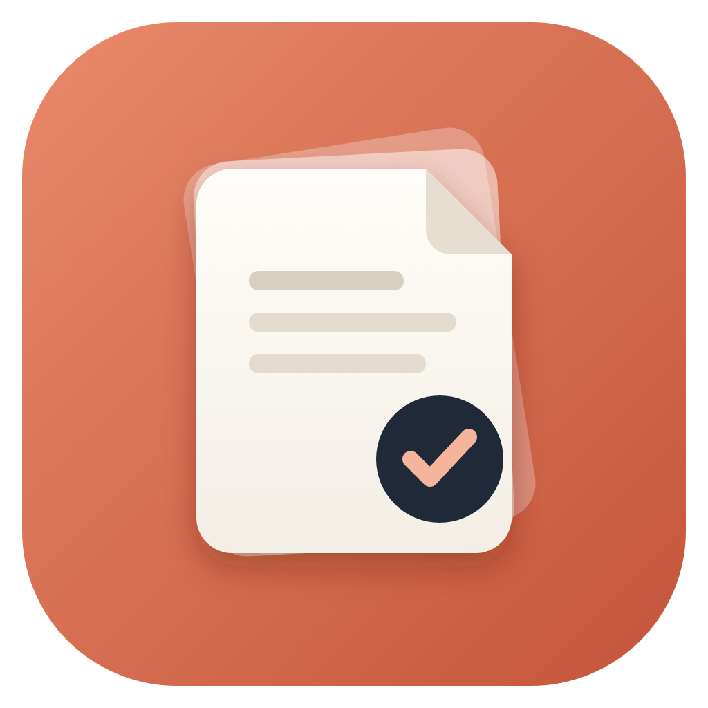
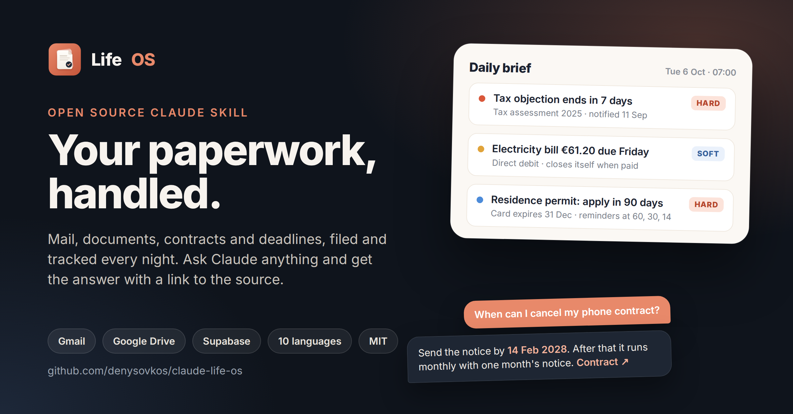

<p align="center">
  
</p>

<h1 align="center">Life OS</h1>

<p align="center">
  <b>Your paperwork, handled.</b><br>
  An open-source Claude skill for Gmail, Google Drive and Supabase
</p>

<p align="center">
  <a href="https://github.com/denysovkos/claude-life-os/releases/latest/download/life-os.zip"></a>
</p>

<p align="center">
  <a href="https://github.com/denysovkos/claude-life-os/releases/latest"></a>
  <a href="https://github.com/denysovkos/claude-life-os/actions/workflows/ci.yml"></a>
  <a href="LICENSE"></a>
  
  
</p>

<p align="center"><b>English</b> · <a href="README.uk.md">Українська</a> · <a href="README.de.md">Deutsch</a> · <a href="README.pl.md">Polski</a> · <a href="README.fr.md">Français</a> · <a href="README.es.md">Español</a> · <a href="README.it.md">Italiano</a> · <a href="README.nl.md">Nederlands</a> · <a href="README.ru.md">Русский</a> · <a href="README.pt.md">Português</a></p>

<p align="center">
  
</p>

A personal system for paperwork. It reads your Gmail and Google Drive, keeps an index of
every formal document, letter, contract and bill in a database you own, and makes sure
no deadline, renewal or expiry slips by. You ask it questions in plain language, in any
Claude chat: "when does my passport expire", "can I still cancel the gym", "what does
the lease say about pets".

It was built by one person for their own life over a month of daily use, and is now
being turned into something anyone can install. No programming needed: Claude walks
you through every step.

## Install

This is for the normal Claude app: claude.ai in the browser, or the Claude desktop or
mobile app.

**1. Download the skill: [life-os.zip](https://github.com/denysovkos/claude-life-os/releases/latest/download/life-os.zip)** (do not unpack it). It is one skill that
contains everything: setup, mail, files, the nightly check, the monthly review and the
answers to your questions. The link always points to the newest version
([all releases](https://github.com/denysovkos/claude-life-os/releases)).

**2. Add it to Claude.** In Claude open **Settings** → **Capabilities**, turn on
**Code execution and file creation** (skills need it), then under **Skills** click
**Upload skill** and choose `life-os.zip`.

**3. Connect your accounts.** **Settings** → **Connectors**: Google Drive, Gmail and
Supabase; if you like also Google Calendar, Todoist, Craft.

**4. Open a new chat and write: `set up life os`.** From here Claude leads. It asks a few
questions (your language, your country, which apps you use), creates the database and
the Drive folders, and checks every step before the next one.

**5. Install the Google Apps Script bridge** when Claude asks. It is one file that runs
in your Google account every 15 minutes, even when Claude does not:

- script.google.com → **New project** → paste the code Claude shows you → save;
- **Project Settings** → **Script Properties** → add `SUPABASE_URL` and
  `SUPABASE_SECRET_KEY` (Claude says where to find them; the key goes only there, never
  into a chat);
- choose the function `install` → **Run** → **Review permissions** → your account →
  "Google hasn't verified this app" → **Advanced** → **Go to Life OS bridge (unsafe)** →
  **Select all** → **Allow**. The warning is normal: it is your own script, running only
  in your account.

Step by step with every permission explained: [docs/apps-script.md](docs/apps-script.md).

**6. Let it run every night.** Claude does not start by itself, so create four scheduled
runs, best at night and in this order: mail at **01:05**, files at **02:05**, the nightly
check with your daily brief at **03:05**, and the monthly review on the 1st at **04:05**.
Mail goes first because its sorting tells the bridge which attachments to copy; an hour
later the file run indexes them the same night; the check comes last so the morning brief
includes everything. The recommended way is four **Claude Code routines**: they run in
Anthropic's cloud, so your computer can be off. Scheduled tasks in the Claude desktop app
work too, if the computer stays on at night. Both, step by step, with the prompts:
[docs/scheduling.md](docs/scheduling.md).

That is all, about 30 minutes. Later, at any time, write **`life os doctor`**: it checks
the whole system and tells you exactly what to fix.

**Updating:** download the new `life-os.zip` and upload it again the same way (remove the
old skill first if Claude does not replace it). Then write `life os doctor`. It shows you
which database updates are missing and what they would change, applies them itself
(no SQL editor needed), and runs the release checks afterwards. Updates never move a deadline you already
have, never remove data, and an older skill keeps working against an updated database, so
nothing breaks if the two are updated a day apart. Every release is tested by upgrading
the previous one with data in it ([CHANGELOG.md](CHANGELOG.md) says what changed). When
the doctor says the Apps Script bridge is outdated, paste the new code over the old one;
[docs/troubleshooting.md](docs/troubleshooting.md) shows how to keep your existing
emergency binder.


### What you need

- A Google account (Gmail and Google Drive).
- A Claude plan that includes skills and connectors.
- A free [Supabase](https://supabase.com) account. Supabase is the database that stores
  the index; the free plan is enough. Claude creates the project for you.
- Optional: Todoist for tasks, Craft for the monthly report. Without them, tasks and
  reports arrive by email and as Google Docs.

## What it does for you

- **Every night** it reads new mail, sorts it into 10 categories (bills, authorities,
  bank, contracts, travel and so on), pulls out amounts and due dates, and creates a task
  when you need to act. Travel and appointments become calendar events.
- **Important attachments** (bills, contracts, letters from authorities) are copied into
  Google Drive automatically, filed into the right folder, and indexed with their full
  text.
- **It tracks deadlines, not just dates.** A residence permit that expires, a letter you
  can object to within a month, an insurance that renews itself unless cancelled three
  months before: each becomes a deadline with reminders that come more often as it gets
  closer. How a deadline is counted depends on your country.
- **A short daily brief**, only on days when something matters. No "all clear" messages.
- **A monthly review**: what you pay every month, what changed, what you can cancel and
  by when, what goes into your tax return, and anything that looks wrong.
- **It catches contracts that renew themselves.** Insurance, phone, internet, energy:
  each needs a cancellation date, and anything that renews with no known exit is listed
  until you or the monthly review fill it in.
- **An emergency binder**: a Google Doc, updated daily, with your open matters,
  deadlines, contracts, insurance, where your original documents are, and who to call.
  Overdue items say so, and a file that disappeared from Drive is marked instead of
  linked.

## Tasks in your task manager

The database keeps the list; the task manager only mirrors it, so nothing is lost if you
switch apps or use none. With Todoist you get:

| Task | When |
|---|---|
| `📅 Daily brief <date>: <most important thing>` | only on days something matters; the brief is in the description |
| `💌 <category> <sender>: <what to do>` | a letter needs you to act |
| `⚠️ <document> expires <date>: <file>` | a document expires within 30 days |
| `🧾 Review <month>: <main decision>` | once a month, the decisions only you can make |
| `⚠️ <job> failed <date>` | a nightly job had errors |

Completing a task closes the deadline behind it. More in [docs/tasks.md](docs/tasks.md).

## Settings

All settings are stored in one table of your own database, `life_settings`, and every
change is recorded in `settings_history`, so it can be seen and undone. To change
something, just say it: "change my language to German", "I moved to Spain", "add my
sister to the emergency binder". When your country or its rules change, deadlines that
were already counted are recounted, after Claude shows you what moves. Details in
[docs/settings.md](docs/settings.md).

## Languages and countries

The system reads mail in any language. Its own output (briefs, tasks, reports, the
emergency binder, folder names) comes in these languages:

| Language | Status |
|---|---|
| English, Deutsch, Українська | complete and tested |
| Polski, Français, Español, Italiano, Nederlands, Русский, Português | starter translation, English where incomplete |

Legal rules (how an objection deadline is counted, when a contract can be cancelled,
until when a purchase can be returned, when the tax return is due) come in a **region
pack**:

| Country | Status |
|---|---|
| 🇩🇪 Germany | complete and tested |
| 🇦🇹 🇫🇷 🇪🇸 🇮🇹 🇳🇱 🇵🇹 🇵🇱 🇬🇧 🇺🇸 🇺🇦 Austria, France, Spain, Italy, Netherlands, Portugal, Poland, United Kingdom, United States, Ukraine | beta: written from the laws cited in each rule, not yet reviewed locally |

Everywhere else the system still tracks every date it reads, but uses cautious
placeholders and asks you about local rules. Corrections to a beta pack, or a new
country, are very welcome: [packs/README.md](packs/README.md).

## Privacy and security

Your data stays in your own accounts: your Gmail, your Drive, your Supabase project.
There is no server in between and nobody else has access. The database is locked so its
public interface returns nothing at all; only Claude (through your own connector) and
your own Apps Script can read it. Files never pass through the AI: Google moves them
directly from Gmail to Drive. Details in [docs/security.md](docs/security.md).

## How it works

Everything that has to happen on time is done by things that do not forget: Google
Apps Script every 15 minutes and scheduled jobs inside the database every night. Claude
does only what needs judgement: reading a letter and understanding what it means. The
database is the single source of truth; Todoist, Craft and the calendar only mirror it.

- [docs/architecture.md](docs/architecture.md): components, data model, a letter's path
  through the system.
- [docs/apps-script.md](docs/apps-script.md): installing the bridge.
- [docs/scheduling.md](docs/scheduling.md): night schedule: times, order.
- [docs/tasks.md](docs/tasks.md): what lands in your task manager and how it closes.
- [docs/settings.md](docs/settings.md): every setting, and what happens when one changes.
- [docs/security.md](docs/security.md): keys, permissions, what the AI sees, backups.
- [docs/troubleshooting.md](docs/troubleshooting.md): every failure the original ran
  into, and what fixes it.

## Repository

```
skills/life-os/    the Claude skill: SKILL.md and its six workflows
                   (also linked at .claude/skills/life-os for Claude Code and routines)
apps-script/       the Google Apps Script bridge (Code.gs)
supabase/          database migrations and the document type registry
packs/             language and region packs
docs/              documentation
tests/             unit tests, SQL checks, the upgrade test, the version guard
scripts/           packaging and JSON formatting
CHANGELOG.md       what each version changed
```

## Development

**Tests.** Without a database:

```
python3 -m unittest discover -s tests -v
```

runs the pack contract tests and the release consistency tests (VERSION, CHANGELOG,
SKILL.md, workflow versions, migration lists and the bridge version agree). With a Postgres
reachable through the usual `PG*` variables:

| Command | What it proves |
|---|---|
| `python3 tests/sql_rules_check.py` | the database counts every region pack example exactly like the packs |
| `psql -f tests/sql/release_checks.sql` | end-of-run views empty, every German term rule, `ingest_assemble` refusing bad md5s, write-backs, recount safety |
| `psql -f tests/sql/feature_checks.sql` | each database feature end to end on throwaway rows |
| `tests/upgrade_check.sh [tag]` | the previous release, with data, upgraded to this checkout: no deadline moves, all checks pass |

The SQL checks run in a transaction that is rolled back, so they are also safe on a live
installation (the doctor runs `release_checks.sql` after an upgrade).

**Pull requests.** CI (`.github/workflows/ci.yml`) runs on every pull request and shows as
checks on it: unit tests; a fresh install of every migration and pack, twice, on
Postgres 16; the rules, release and feature checks; the upgrade test; the deny-all checks
(no table, grant or function open to the public API); and a build of `life-os.zip`,
downloadable from the run. A pull request that changes anything that ships (the skill,
migrations, seed, packs, Apps Script, docs) must also raise `VERSION` and add a section on
top of `CHANGELOG.md`; the version check fails it otherwise.

**Releases.** The version is the number in `VERSION`, nothing else: SKILL.md, the
CHANGELOG, the git tag and the GitHub release all say the same. When a merge to `main`
brings a `VERSION` that has no tag yet and CI passes on that commit,
`.github/workflows/release.yml` tags it `v<VERSION>` and publishes a release with
`life-os.zip` and that version's CHANGELOG section as notes. A merge that does not change
`VERSION` publishes nothing. Patch for fixes, minor for new features, and every database
change is a new, additive migration.

## License

[MIT](LICENSE).

## Status

Early, and in daily use. The database, the bridge and the intakes have run every night
since the original private version and were then generalised; 4.2 fixed what a month of
unattended night runs exposed (see [CHANGELOG.md](CHANGELOG.md)). The setup skill and the
beta packs are newer. Expect rough edges and please report them.
